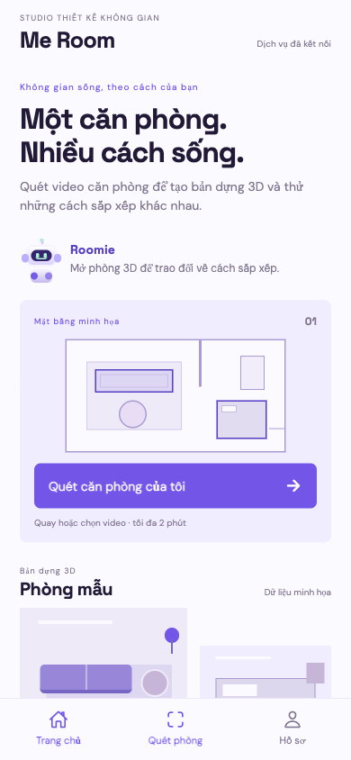
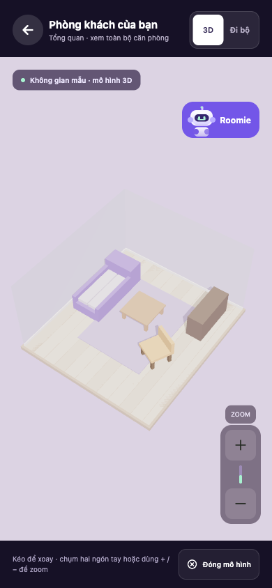
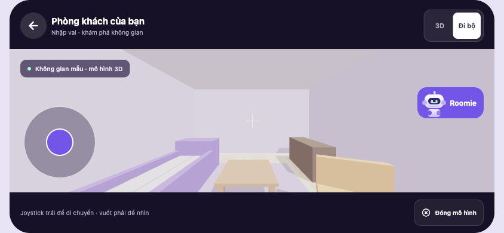
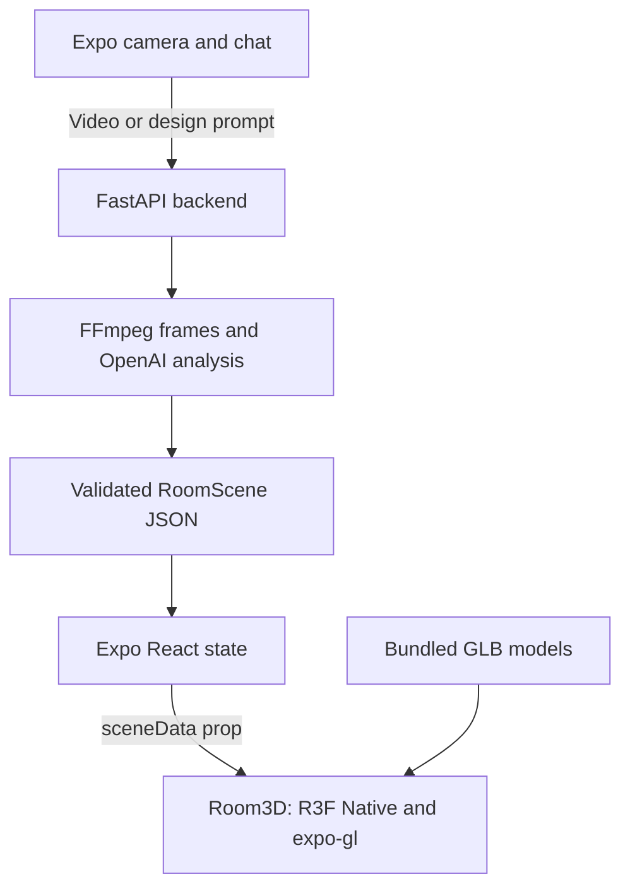

# 🏠 Me Room

**Scan your space. Reimagine your room. Bring your ideas to life with AI.**

## Application Screenshots

The screenshots below are captured from the running web application at iPhone 13 viewport dimensions, not from a physical iPhone.
Sample rooms contain synthetic scene data and are labeled as samples in the app.

| Home | Room capture |
| --- | --- |
|  |  |

| Third-person overview | First-person walkthrough |
| --- | --- |
|  |  |

Built for AI IN YOUR PALM Hackathon 2026.

Me Room aims to turn a room-scanning video into an approximate 3D room and let users redesign it through chat.
The selected architecture is a single Expo mobile application with native 3D rendering and a FastAPI backend for AI processing.
The backend now implements `/health`, `/scan`, and stateless `/design`, with validation, frame extraction, OpenAI integration, and automated tests.
See [backend/README.md](backend/README.md) for installation, commands, API examples, and limitations.
The Expo application now includes capture, upload, processing, two sample rooms, native/web 3D viewing, and design chat.
Bundled textured GLB assets remain future work; the renderer currently uses furniture geometry fallbacks.

## Project Structure

```text
.
├── mobile/                         # One Expo / React Native application
│   ├── AGENTS.md
│   ├── .codex/                     # Mobile app crewmates
│   ├── app/                        # Screens, camera, API calls, state, and chat
│   ├── components/
│   │   └── Room3D/                 # Native 3D component and its crewmates
│   │       ├── AGENTS.md
│   │       └── .codex/
│   └── assets/
│       └── models/                 # Future bundled GLB models
├── backend/                        # FastAPI, FFmpeg, OpenAI
│   ├── AGENTS.md
│   └── .codex/                     # Backend and AI crewmates
├── shared/
│   ├── AGENTS.md
│   ├── README.md                   # Draft contract conventions
│   └── example.json                # Synthetic RoomScene example
├── docs/images/                    # Actual application screenshots
└── AGENTS.md                       # Repository contributor guide
```

The previous `frontend/` team now lives in `mobile/`.
The previous `viewer/` team now lives in `mobile/components/Room3D/` and owns the native renderer.
The old empty `room-sence.example.json` placeholder has been replaced by `shared/example.json`.

## Architecture



The mobile app owns the current RoomScene and supplies it to the renderer:

```tsx
<Room3D sceneData={roomScene} />
```

The native 3D component updates when `sceneData` changes.
Rendering happens inside the Expo app; there is no separate viewer server, viewer URL, or WebView messaging bridge in the selected design.
Room reconstruction remains approximate; scene estimates, model quality, textures, and lighting determine how closely the result resembles the real room.

## Team Responsibilities

See the [team implementation guide](docs/huong-dan-thanh-vien.md) for Khải, Tú, and Quang's responsibilities, handoffs, verification, and agent workflows.

| Owner | Scope | Deliverable |
| --- | --- | --- |
| Khải, mobile app | `mobile/app/` and app-level API/state integration | Capture, upload, loading, room screen, and AI chat |
| Tú, backend and AI | `backend/` | Video analysis and validated scene/design responses |
| Quang, native 3D | `mobile/components/Room3D/` and `mobile/assets/models/` | Reusable native `Room3D` component, GLB placement, lighting, and touch controls |
| All three leads | `shared/` and mobile dependency configuration | One consistent scene contract and compatible runtime |

Khải and Quang work in the same Expo project with separate file ownership.
Agree ownership before editing `mobile/package.json`, the lockfile, Metro configuration, or app configuration once those files exist.

## Stack and API

| Area | Technology |
| --- | --- |
| Mobile | Expo, React Native, TypeScript |
| Native 3D | `@react-three/fiber/native`, Three.js, `expo-gl`, `expo-asset` |
| Backend | Python, FastAPI, Pydantic |
| AI and video | OpenAI API and FFmpeg |
| Shared data | RoomScene JSON |

| Endpoint | Purpose |
| --- | --- |
| `POST /scan` | Accept video and return a RoomScene |
| `POST /design` | Apply a design prompt and return the updated RoomScene |
| `GET /health` | Report backend health |

`POST /scan` accepts a multipart field named `video`.
`POST /design` accepts `{ "scene": <complete RoomScene>, "prompt": "..." }` and returns a complete updated scene; the backend does not store sessions.
See [backend/README.md](backend/README.md) for limits and error responses.
See [shared/README.md](shared/README.md) for the draft scene shape and coordinate conventions.

## Development Status and Next Steps

The backend and Expo application are implemented in `backend/` and `mobile/`.
The app uses Expo SDK 58, React Native 0.88, and R3F 9 inside one Expo project.
The web preview shares scene and camera logic with the native renderer.
The separate legacy `viewer/` is not required to run the Expo app.

Videos are limited to 120 seconds and 250 MiB; recording has no artificial five-second minimum.
The upload client uses React Native's file-URI multipart path on iOS and a Blob on web, with actual file sizes taking precedence over picker metadata.
Direct recordings do not capture audio, while selected library videos may contain audio.
On supported iOS rear cameras, the lens selector exposes the actual ultra-wide 0.5x and standard 1x lenses before recording.
Third-person mode provides an elevated oblique view with drag-to-orbit and zoom.
The mobile interface keeps the original purple and lavender palette with cleaner layouts and more room for the 3D viewport.
First-person mode requests native landscape orientation and provides movement controls and swipe-to-look.
Physical iPhone verification remains required for lens switching, simultaneous touch controls, and orientation behavior.

Before committing to the native renderer for the demo, test on the actual iPhone:

1. Render a box and move the camera using touch.
2. Render multiple objects from the shared example, then change the data to show a second layout.
3. Load a textured GLB and verify its dimensions, orientation, and placement.

Only reconsider the rendering architecture after reporting concrete device failures to the team.
Simulator or desktop checks alone do not prove native iPhone rendering works.

## Starting the Coding Crewmates

Run one of these commands from the repository root:

```sh
codex -C backend "Use the backend crewmates to implement and verify <task>."
codex -C mobile "Use the mobile crewmates to implement and verify <task>."
codex -C mobile/components/Room3D "Use the native 3D crewmates to implement and verify <task>."
```

Each main session is its team's lead and delegates to coder, tester, reviewer, and confirmer roles.
Read the corresponding `.codex/TEAM.md` for ownership, messaging, and verification rules.
These configurations define on-demand teammates; they do not launch persistent workers.

## Demo and Roadmap

The target demo is iPhone capture, AI scene analysis, native 3D exploration, and chat-driven room updates.
### Run on iPhone 13 with Expo Go

Connect the Mac and iPhone to the same trusted Wi-Fi network and install Expo Go compatible with SDK 58.
Install mobile dependencies with `npm ci` inside `mobile/`; follow [backend setup](backend/README.md) for the Python virtual environment and FFmpeg.
Run these commands in separate terminals from the repository root:

```sh
cd backend
.venv/bin/uvicorn main:app --host 0.0.0.0 --port 8001
```

```sh
cd mobile
EXPO_PUBLIC_API_BASE_URL=http://192.168.1.84:8001 npm start -- --lan --port 8082
```

Scan the terminal QR code with the iPhone Camera app and open it in Expo Go.
The current development link is `exp://192.168.1.84:8082`.


This QR code points to the current Mac LAN address and works only while that Expo session is running on the same network.
If Expo Go requests sign-in, use the same Expo account on the phone and in Expo CLI with `npx expo login`.
See the [official Expo Go instructions](https://docs.expo.dev/get-started/start-developing/) for connection troubleshooting.

`192.168.1.84` is this Mac's current LAN address and may change between networks.
Check it with `ipconfig getifaddr en0` and substitute your actual address in the command above.
To persist the public API address, set `EXPO_PUBLIC_API_BASE_URL=http://192.168.1.84:8001` in `mobile/.env`, restart Expo, and reload the app.
Open `http://192.168.1.84:8001/health` in iPhone Safari to check backend connectivity.

The backend uses port `8001`; Expo uses port `8082` in this session.
Do not set the API address to `http://localhost:8081`: localhost on the iPhone refers to the phone, and the Expo server does not implement `/scan` or `/design`.
Keep the Mac's terminal processes running while testing.

### Verification

```sh
cd mobile
npm run typecheck
npm test
```

From the repository root:

```sh
backend/.venv/bin/python -m pytest backend/tests -q
backend/.venv/bin/ruff check backend
backend/.venv/bin/ruff format --check backend
```

Automated tests mock the AI boundary and do not establish paid-provider readiness or room reconstruction accuracy.
Live `/scan` checks on November 14, 2026 returned HTTP 200 for both repository samples: `video.mp4` (4.81 MiB, 30.77 seconds) and `video_2.mp4` (3.05 MiB, 19.57 seconds).
Their processing times were approximately 62 and 31 seconds respectively; these are observed runs, not latency guarantees.
A subsequent test invoked the app's actual `scanRoom` function on the connected physical iPhone with `video_2.mp4`, completed in approximately 36 seconds, and returned a validated scene with 15 objects.
This verifies native file upload and backend analysis; it does not verify tapping through the camera or photo picker UI.
After raising the upload limit, the user's MOV file of 90,810,166 bytes (86.6 MiB) uploaded from the physical iPhone received HTTP 200, and the user confirmed that the resulting 3D room appeared in the app.
Generated scenes remain approximate, and uploaded files and API response artifacts must stay out of Git.
Web screenshots and iOS bundle exports do not establish physical-device behavior.

Future ideas include more accurate scanning, richer furniture models, voice commands, and room sharing.

## Security

Keep OpenAI credentials on the backend and never bundle them in the mobile app.
Use synthetic scenes for shared fixtures and keep private room recordings out of source control and logs.
Obtain explicit user authorization before pushing or deploying.
