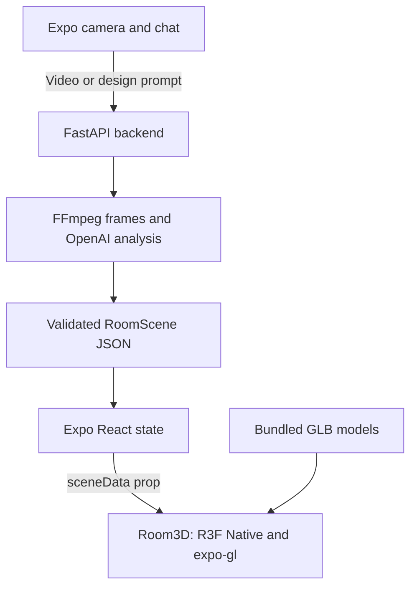

# 🏠 Me Room

**Scan your space. Reimagine your room. Bring your ideas to life with AI.**

Built for AI IN YOUR PALM Hackathon 2026.

Me Room aims to turn a room-scanning video into an approximate 3D room and let users redesign it through chat.
The selected architecture is a single Expo mobile application with native 3D rendering and a FastAPI backend for AI processing.
This checkout currently contains the project structure, contributor guides, Codex team configurations, and a synthetic JSON example.
The application, APIs, GLB assets, dependency manifests, and tests still need implementation.

## Project Structure

```text
.
├── mobile/                         # One Expo / React Native application
│   ├── AGENTS.md
│   ├── .codex/                     # Mobile app crewmates
│   ├── app/                        # Future screens: scan, room, chat
│   ├── components/
│   │   └── Room3D/                 # Native 3D component and its crewmates
│   │       ├── AGENTS.md
│   │       └── .codex/
│   └── assets/
│       └── models/                 # Future bundled GLB models
├── backend/                        # FastAPI, FFmpeg, OpenAI
│   ├── AGENTS.md
│   └── .codex/                     # Backend and AI crewmates
├── shared/
│   ├── AGENTS.md
│   ├── README.md                   # Draft contract conventions
│   └── example.json                # Synthetic RoomScene example
└── AGENTS.md                       # Repository contributor guide
```

The previous `frontend/` team now lives in `mobile/`.
The previous `viewer/` team now lives in `mobile/components/Room3D/` and owns the native renderer.
The old empty `room-sence.example.json` placeholder has been replaced by `shared/example.json`.

## Architecture



The mobile app owns the current RoomScene and supplies it to the renderer:

```tsx
<Room3D sceneData={roomScene} />
```

The native 3D component updates when `sceneData` changes.
Rendering happens inside the Expo app; there is no separate viewer server, viewer URL, or WebView messaging bridge in the selected design.
Room reconstruction remains approximate; scene estimates, model quality, textures, and lighting determine how closely the result resembles the real room.

## Team Responsibilities

| Owner | Scope | Deliverable |
| --- | --- | --- |
| Khải, mobile app | `mobile/app/` and app-level API/state integration | Capture, upload, loading, room screen, and AI chat |
| Tú, backend and AI | `backend/` | Video analysis and validated scene/design responses |
| Quang, native 3D | `mobile/components/Room3D/` and `mobile/assets/models/` | Reusable native `Room3D` component, GLB placement, lighting, and touch controls |
| All three leads | `shared/` and mobile dependency configuration | One consistent scene contract and compatible runtime |

Khải and Quang work in the same Expo project with separate file ownership.
Agree ownership before editing `mobile/package.json`, the lockfile, Metro configuration, or app configuration once those files exist.

## Planned Stack and API

| Area | Technology |
| --- | --- |
| Mobile | Expo, React Native, TypeScript |
| Native 3D | `@react-three/fiber/native`, Three.js, `expo-gl`, `expo-asset` |
| Backend | Python, FastAPI, Pydantic |
| AI and video | OpenAI API and FFmpeg |
| Shared data | RoomScene JSON |

| Endpoint | Planned purpose |
| --- | --- |
| `POST /scan` | Accept video and return a RoomScene |
| `POST /design` | Apply a design prompt and return the updated RoomScene |
| `GET /health` | Report backend health |

Agree multipart field names, error responses, and whether `/design` receives the scene or a server-managed `sceneId` before implementing clients.
See [shared/README.md](shared/README.md) for the draft scene shape and coordinate conventions.

## Development Status and Next Steps

There are no working application build or start commands yet.
Initialize the Expo app inside `mobile/`, preserving its existing agent guides and the native 3D team's files.
Create the FastAPI application and its dependency manifest inside `backend/`.
Do not create a second Expo project inside `Room3D/`.

When the Expo project exists, install Expo-compatible native dependencies and choose an R3F version matching its React version.
The [official R3F Native installation guide](https://r3f.docs.pmnd.rs/getting-started/installation#react-native) describes the native import, Expo dependencies, and Metro asset handling.
Keep Metro defaults when adding GLB support, and verify access to the shared JSON from the selected Expo configuration.

Before committing to the native renderer for the demo, test on the actual iPhone:

1. Render a box and move the camera using touch.
2. Render multiple objects from the shared example, then change the data to show a second layout.
3. Load a textured GLB and verify its dimensions, orientation, and placement.

Only reconsider the rendering architecture after reporting concrete device failures to the team.
Simulator or desktop checks alone do not prove native iPhone rendering works.

## Starting the Coding Crewmates

Run one of these commands from the repository root:

```sh
codex -C backend "Use the backend crewmates to implement and verify <task>."
codex -C mobile "Use the mobile crewmates to implement and verify <task>."
codex -C mobile/components/Room3D "Use the native 3D crewmates to implement and verify <task>."
```

Each main session is its team's lead and delegates to coder, tester, reviewer, and confirmer roles.
Read the corresponding `.codex/TEAM.md` for ownership, messaging, and verification rules.
These configurations define on-demand teammates; they do not launch persistent workers.

## Demo and Roadmap

The target demo is iPhone capture, AI scene analysis, native 3D exploration, and chat-driven room updates.
Demo video and app installation instructions will be added after implementation and verification.
Future ideas include more accurate scanning, richer furniture models, voice commands, and room sharing.

## Security

Keep OpenAI credentials on the backend and never bundle them in the mobile app.
Use synthetic scenes for shared fixtures and keep private room recordings out of source control and logs.
Obtain explicit user authorization before pushing or deploying.
